<div align="center">

<a href="https://subhancoder.me">
  
</a>

<br>

<a href="https://subhancoder.me">
  
</a>

<p>
  <a href="https://subhancoder.me"><strong>ENTER PORTFOLIO →</strong></a>
  &nbsp;&nbsp;·&nbsp;&nbsp;
  <a href="https://www.linkedin.com/in/subhan-ahmed-8a511b21b/">LinkedIn</a>
  &nbsp;&nbsp;·&nbsp;&nbsp;
  <a href="mailto:subhanahmed152@gmail.com">Email</a>
</p>

</div>

---

## `> whoami`

```text
IDENTITY
  name        :: Subhan Ahmed
  location    :: Karachi, Pakistan
  focus       :: iOS development · SwiftUI · applied AI
  status      :: learning, building, shipping
```

I'm a software engineering student focused on building thoughtful native iOS applications with **Swift** and **SwiftUI**, while exploring how applied AI can make software more useful. I also enjoy working across the web stack when a product needs a broader surface.

My approach is simple: make the experience clear, make the engineering solid, and keep improving the details.

## `> load_tech_stack --core`

<div align="center">


</div>

## `> ls ~/featured-projects`

| Project | Verified description |
|:--|:--|
| [**Subhan-Portfolio**](https://github.com/Subhan-2004/Subhan-Portfolio) | My personal portfolio website. |
| [**siliconst-ticket-system-v2**](https://github.com/Subhan-2004/siliconst-ticket-system-v2) | Ticket-system project. |
| [**AI-Swim-Coach**](https://github.com/Subhan-2004/AI-Swim-Coach) | iOS application using the device camera and Apple's Vision framework to analyze body movements in real time. |
| [**CareerPath-AI**](https://github.com/Subhan-2004/CareerPath-AI) | Personalized, AI-driven web application for planning, tracking, and navigating learning journeys. |
| [**AI-Coding-Teacher**](https://github.com/Subhan-2004/AI-Coding-Teacher) | AI coding teacher web app built in Python. |
| [**ToDo-SwiftUi-App**](https://github.com/Subhan-2004/ToDo-SwiftUi-App) | To-do iOS app. |

<div align="center">
  <a href="https://subhancoder.me/#projects"><strong>VIEW THE FULL PROJECT ARCHIVE →</strong></a>
</div>

## `> cat achievements.log`

```text
[UNLOCKED] WordSprint Developers Hackathon 5.0
           Third Place — VersaMaint team project

[CERTIFIED] Meta iOS Developer Professional Certificate
[CERTIFIED] IBM Generative AI Engineering Professional Certificate

[COMPLETED] Co-Creating with GPT-5
            lablab.ai certificate of participation / completion
```

## `> system.monitor --github`

<div align="center">

<a href="https://github.com/Subhan-2004">
  
</a>
<a href="https://github.com/Subhan-2004">
  
</a>

<br>

<a href="https://github.com/Subhan-2004">
  
</a>

</div>

<sub>External stats are supplementary; the profile remains readable if a stats service is unavailable.</sub>

<details>
<summary><strong>⚡ ./more_about_me.sh — execute to reveal</strong></summary>

<br>

```yaml
interests:
  - swimming
  - football
  - gaming
  - creative technology

working_style:
  - keep learning
  - build useful things
  - improve the details
```

</details>

---

<div align="center">

## `> establish_connection --secure`

Have an interesting project, internship opportunity, or collaboration in mind?

<a href="https://subhancoder.me"><strong>LAUNCH PORTFOLIO</strong></a>
&nbsp;&nbsp;·&nbsp;&nbsp;
<a href="mailto:subhanahmed152@gmail.com">SEND EMAIL</a>
&nbsp;&nbsp;·&nbsp;&nbsp;
<a href="https://www.linkedin.com/in/subhan-ahmed-8a511b21b/">CONNECT ON LINKEDIN</a>

<br><br>

```text
> connection.status
CONNECTED

> developer.status
BUILDING THE FUTURE
```

<sub>© Subhan Ahmed // Code. Create. Evolve.</sub>

</div>
